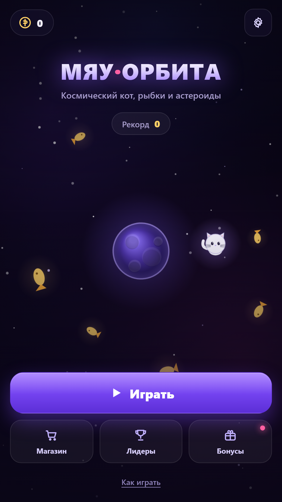

# МЯУ·ОРБИТА / Meow Orbit

Космическая аркада про кота, который наматывает круги вокруг маленькой планеты. Один тап — и кот перескакивает на соседнюю орбиту: 1 → 2 → 3 → 2 → 1 и так далее. Собирай золотых рыбок, держи комбо и не задень астероид.

**Играть: https://maybe.su/meow-orbit/**



## Что внутри

- Три орбиты: третья открывается на 1000 очков.
- Бонусы: щит, магнит и замедление времени.
- 12 скинов кота, магазин за монеты.
- Ежедневная награда и три миссии на день.
- Таблица рекордов и облачные сохранения.
- Русский, English, Türkçe — язык определяется автоматически.
- Работает без Yandex SDK: реклама и покупки подключаются только внутри Яндекс Игр.

## Управление

- Телефон и планшет: тап в любом месте экрана.
- Компьютер: клик, `Space`, `↑` или `W`. Пауза — `Esc` / `P`.

## Структура

```
index.html        разметка всех экранов
css/style.css     UI, общая ширина контента --content
js/game.js        движок: орбиты, спавн, коридор безопасности, рендер
js/ui.js          экраны, магазин, миссии, награды
js/sdk.js         обёртка Yandex Games SDK (реклама, покупки, лидерборды)
js/save.js        сохранения и облако
js/i18n.js        локализация RU/EN/TR
tools/build.js    сборка однофайлового dist/index.html + zip
assets/           иконка, обложки, скриншоты, промо
```

## Сборка

```bash
node tools/build.js          # dist/index.html + meow-orbit.zip
node tools/serve.js 8123     # локальный сервер: http://localhost:8123/
```

Однофайловая сборка нужна для площадок, которые вставляют игру через `srcdoc` (черновик Яндекс Игр): относительные пути `css/` и `js/` там не разрешаются.

## Публикация

- GitHub Pages: ветка `gh-pages`, один файл `index.html`.
- Яндекс Игры: черновик 653261, архив `meow-orbit.zip` (index.html в корне).
- itch.io: `meow-orbit.zip`, обложка `assets/itch-cover-630x500.png`, описание `assets/itch-description.html`.

## Лицензия

Код и ассеты — © Meow Orbit. Игра распространяется как есть, без гарантий.
